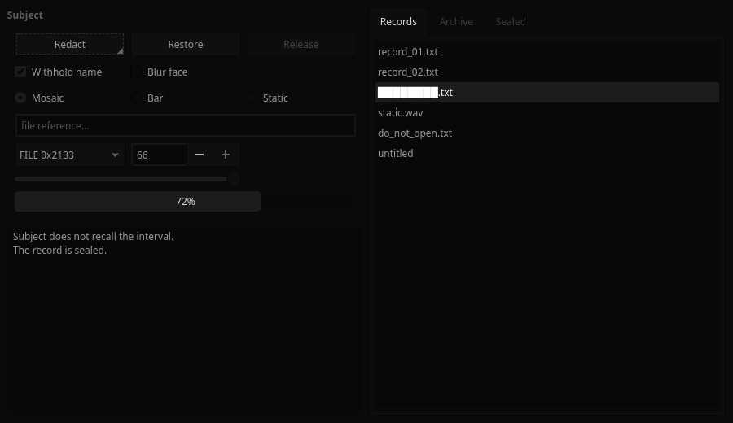

# Redacted — Kvantum Theme

A Kvantum widget style in monochrome black: recessed fields, grey sliders and checks, and selections that read by brightness rather than colour.



Redacted is a monochrome-black look for KDE Plasma 6 about obfuscation and censorship. Every colour is a neutral grey, and the accents sit only a few levels above black: almost imperceptible, but just perceptible. The motifs are static, mosaic pixelation, black censor bars and a dissociated double.

## Features

- Built on KvArcDark's engine map. The greys are remapped onto a near-black ramp, and Arc's blue becomes grey.
- Text fields sit recessed, darker than the buttons.
- Sliders, checks, progress bars and focus rings are a few grey levels above their surface.
- Blurred popups. Matches the Redacted colour scheme.


## Requirements

Kvantum (`kvantum` package), with the widget style set to kvantum.

## Install

```bash
git clone https://github.com/numbpill3d/redacted-kvantum
cd redacted-kvantum && ./install.sh
```

Or from the KDE Store: Extract it to `~/.config/Kvantum/`, select **Redacted** in Kvantum Manager, then set the Application Style to kvantum.

## The rest of the suite

| piece | repo |
|---|---|
| Global theme + splash screen | [redacted-global](https://github.com/numbpill3d/redacted-global) |
| Plasma style (panel, popups) | [redacted-plasma](https://github.com/numbpill3d/redacted-plasma) |
| Aurorae window decoration | [redacted-aurorae](https://github.com/numbpill3d/redacted-aurorae) |
| Colour scheme | [redacted-colors](https://github.com/numbpill3d/redacted-colors) |
| Icon theme | [redacted-icons](https://github.com/numbpill3d/redacted-icons) |
| Konsole + kitty colours | [redacted-konsole](https://github.com/numbpill3d/redacted-konsole) |
| SDDM login | [redacted-sddm](https://github.com/numbpill3d/redacted-sddm) |
| Plymouth boot splash | [redacted-plymouth](https://github.com/numbpill3d/redacted-plymouth) |
| Animated wallpaper (desktop + lock) | [redacted-wallpaper](https://github.com/numbpill3d/redacted-wallpaper) |
| Still wallpaper (1080p–4K) | [redacted-image-wallpaper](https://github.com/numbpill3d/redacted-image-wallpaper) |
| KWin open/close effect | [redacted-censor](https://github.com/numbpill3d/redacted-censor) |
| KWin script: active window under review | [redacted-static](https://github.com/numbpill3d/redacted-static) |
| Clock plasmoid | [redacted-clock](https://github.com/numbpill3d/redacted-clock) |

Everything at once, with the generators: [redacted-kde](https://github.com/numbpill3d/redacted-kde).

## Tags

`redacted` `kde` `plasma6` `dark` `black` `monochrome` `grayscale` `minimal` `censored` `glitch` `static` `pixel` `kvantum` `qt-style` `widget-style` `qt6` `qt5`

## Credits and licence

By splicer scorn (voidrane). GPL-3.0-or-later.
Engine map adapted from KvArcDark by Tsu Jan (Kvantum, GPL-3.0).
